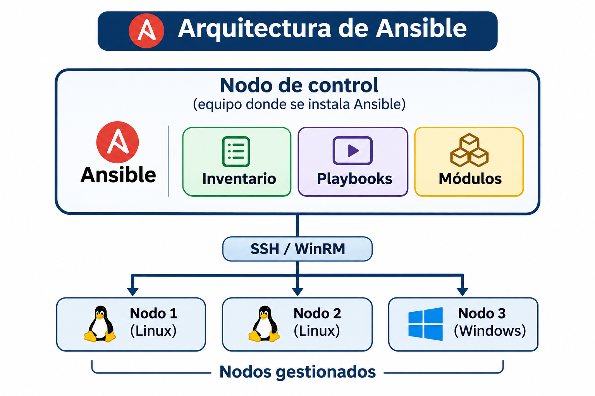

# UT4. Ansible

!!! abstract "Resultado de aprendizaje"
    Esta unidad trabaja el **RA3** del RD 1629/2009: *Gestiona la automatización de tareas del sistema, aplicando criterios de eficiencia y utilizando comandos y herramientas gráficas.*

    **Duración:** 8 horas.

## 1. Introducción

### 1.1 ¿Por qué automatizar?

Piensa en el aula de informática al empezar el curso: hay que instalar los mismos programas en todos los equipos, crear las cuentas del alumnado y dejar la red configurada. Hacerlo equipo por equipo lleva horas y, al final, siempre hay alguno al que le falta algo. Con los servidores ocurre lo mismo, con el agravante de que un error puede dejar un servicio sin funcionar.

Automatizar la administración aporta:

- **Rapidez**: lo que llevaba horas se hace en minutos y en paralelo.
- **Coherencia**: todos los equipos quedan exactamente igual.
- **Escalabilidad**: da igual gestionar 2 equipos que 200.
- **Trazabilidad**: la configuración queda escrita en ficheros que se pueden revisar y versionar con Git, como vimos en la UT0.

Este enfoque se conoce como **Infraestructura como Código (IaC, *Infrastructure as Code*)**: la infraestructura se describe en ficheros de texto legibles, versionables y reutilizables, en lugar de configurarse a mano.

### 1.2 ¿Qué es Ansible?

!!! note "Información"
    **Ansible** es una herramienta de automatización de código abierto, creada en 2012 y mantenida por Red Hat desde 2015. Describimos en ficheros YAML **cómo queremos que estén** los equipos, y Ansible se conecta a ellos y hace lo necesario para que queden así, actuando sobre muchos equipos a la vez desde un único punto de control.

Con Ansible se puede, entre otras cosas:

- Instalar y actualizar software.
- Crear usuarios y gestionar permisos.
- Configurar y arrancar servicios.
- Aplicar parches y medidas de seguridad.
- Desplegar una aplicación en varios servidores siguiendo un orden concreto.

### 1.3 Ansible frente a scripts

Hasta ahora hemos automatizado tareas con scripts Bash y cron. Ansible no los reemplaza, sino que los complementa para un nivel superior de automatización:

| Característica | Scripts Bash + cron | Ansible |
| -------------- | ------------------- | ------- |
| Ejecución en múltiples servidores | Requiere bucles y SSH manual | Nativo, en paralelo |
| Idempotencia | Hay que programarla explícitamente | Incorporada en los módulos |
| Legibilidad | Depende del programador | YAML declarativo y autodocumentado |
| Gestión de errores | Manual | Gestionada automáticamente |
| Sistemas heterogéneos (Linux + Windows) | Complejo | Soporte nativo |
| Curva de aprendizaje | Baja (si sabes bash) | Baja (YAML, sin agente) |

!!! note "Información"
    **Idempotencia**: una operación es idempotente cuando ejecutarla varias veces produce el mismo resultado que ejecutarla una sola vez. Por ejemplo, el módulo `user` de Ansible crea el usuario si no existe, pero no hace nada si ya existe. Un script con `useradd` daría error la segunda vez.

### 1.4 Casos de uso habituales en administración de sistemas

- Aprovisionar nuevos servidores con la configuración base (usuarios, paquetes, seguridad).
- Desplegar y actualizar configuraciones en toda la infraestructura de forma simultánea.
- Crear y gestionar usuarios en masa.
- Instalar, configurar y arrancar servicios (Apache, SSH, MariaDB, etc.).
- Programar tareas cron en múltiples equipos.
- Gestionar entornos mixtos Linux/Windows.

---

## 2. Arquitectura de Ansible

### 2.1 Nodos y componentes

Ansible sigue una arquitectura **agentless** (sin agente): no es necesario instalar ningún software en los equipos gestionados. La comunicación se realiza a través de **SSH** en Linux/Unix y **WinRM** en Windows.

{ width=700 }

| Componente | Descripción |
| ---------- | ----------- |
| **Control Node** | Equipo donde se instala Ansible y desde donde se lanzan las automatizaciones. Debe ser Linux/macOS (en Windows, mediante WSL). Puede ser una máquina física, una virtual o incluso un contenedor. |
| **Managed Nodes** | Equipos gestionados: servidores Linux o Windows, dispositivos de red, plataformas cloud... No requieren instalar Ansible. Solo necesitan acceso remoto y Python (Linux) o PowerShell/WinRM (Windows). |
| **Inventario** | Fichero que lista los managed nodes, agrupados según su función. |
| **Playbook** | Fichero YAML que describe el estado deseado de los managed nodes. |
| **Play** | Conjunto de tareas que se aplican a un grupo de hosts. |
| **Task** | Acción individual dentro de un play que invoca un módulo. |
| **Módulo** | Unidad de trabajo de Ansible (instalar un paquete, crear un usuario, copiar un fichero...). |
| **Role** | Forma de organizar tareas, variables, plantillas y ficheros en una estructura reutilizable. |

### 2.2 ¿Cómo ejecuta Ansible una tarea?

Cuando lanzamos una tarea, Ansible:

1. Lee el inventario para saber a qué equipos tiene que conectarse.
2. Se conecta por SSH a cada managed node (en paralelo).
3. **Copia** el módulo correspondiente (un pequeño programa en Python) a un directorio temporal del nodo.
4. **Ejecuta** el módulo, que comprueba el estado actual y solo hace cambios si es necesario.
5. **Elimina** el módulo y devuelve el resultado al control node (`ok`, `changed`, `failed`...).

Por eso los managed nodes no necesitan ningún agente: basta con SSH y Python.

### 2.3 Paquetes de Ansible y colecciones

Al instalar Ansible conviene distinguir dos paquetes:

- **`ansible-core`**: contiene los comandos (`ansible`, `ansible-playbook`, `ansible-vault`...) y los módulos básicos, agrupados en la colección `ansible.builtin`.
- **`ansible`**: incluye `ansible-core` y, además, decenas de **colecciones** (*collections*) de la comunidad con módulos para MySQL, Docker, Windows, la nube... Es el que instalaremos.

Para entornos empresariales, Red Hat comercializa **Ansible Automation Platform**, que añade soporte y una consola web; su versión libre equivalente es **AWX**. En clase trabajaremos siempre desde la línea de comandos.

!!! note "Información"
    Cada módulo tiene un **nombre completo** (*FQCN, Fully Qualified Collection Name*) formado por la colección y el nombre del módulo: `ansible.builtin.apt`, `ansible.builtin.user`, `community.mysql.mysql_db`... Escribir el nombre completo deja claro de dónde sale cada módulo y es una buena práctica que seguiremos en toda la unidad.

---

## 3. Entorno de laboratorio

### 3.1 Escenario

Todos los ejemplos y actividades de la unidad se realizan sobre **contenedores Docker** que hacen de servidores Ubuntu. El escenario reproduce, a pequeña escala, los servidores de un instituto: dos servidores web para la **intranet del centro** y dos servidores de bases de datos para la **aplicación de gestión de la biblioteca**. Un quinto contenedor hace de control node.

| Contenedor | Rol | Grupo |
| ---------- | --- | ----- |
| `control` | Control node — Ansible instalado aquí | — |
| `web1` | Servidor web de la intranet | `webservers` |
| `web2` | Servidor web de la intranet | `webservers` |
| `db1` | Servidor de bases de datos | `dbservers` |
| `db2` | Servidor de bases de datos | `dbservers` |

Todos los contenedores están conectados a la red de Docker **`ansible-net`**. Dentro de una red creada por el usuario, Docker resuelve los nombres de los contenedores, así que desde `control` podemos llegar a los demás por su nombre (`ssh ubuntu@web1`) sin preocuparnos de sus IP.

!!! warning "Diferencias con un servidor real"
    Un contenedor no es una máquina virtual completa. Para esta unidad hay que tener en cuenta que:

    - **No tienen systemd.** Los servicios se gestionan con sus scripts clásicos de `/etc/init.d` (`service apache2 start`), y Ansible lo detecta solo. Por eso, aunque se use `enabled: true`, los servicios **no arrancan solos** si se reinicia el contenedor: basta con volver a ejecutar el playbook (otra ventaja de la idempotencia).
    - **Comparten el kernel y la memoria del equipo anfitrión.** Hechos como `ansible_facts['kernel']` o `ansible_facts['memtotal_mb']` muestran los datos del equipo real, iguales en todos los contenedores.

### 3.2 Imagen de los servidores: `Dockerfile`

Todos los contenedores, incluido el control node, usan la misma imagen: un Ubuntu 24.04 con SSH, `sudo` y Python 3, que es todo lo que Ansible necesita en un managed node.

Crea un directorio `laboratorio-ansible/` y guarda dentro este `Dockerfile`:

```dockerfile
FROM ubuntu:24.04

# cron: para practicar con el módulo cron de Ansible
# iproute2: comando ip, que Ansible usa para obtener los datos de red de cada nodo
RUN apt-get update && apt-get install -y \
    openssh-server \
    sudo \
    python3 \
    cron \
    iproute2 \
    && rm -rf /var/lib/apt/lists/*

# El usuario ubuntu ya existe, solo establecemos contraseña y permisos
RUN echo "ubuntu:ubuntu" | chpasswd && \
    usermod -aG sudo ubuntu && \
    echo "ubuntu ALL=(ALL) NOPASSWD:ALL" >> /etc/sudoers

# Configurar SSH
RUN mkdir /var/run/sshd && \
    sed -i 's/#PasswordAuthentication yes/PasswordAuthentication yes/' /etc/ssh/sshd_config && \
    sed -i 's/PasswordAuthentication no/PasswordAuthentication yes/' /etc/ssh/sshd_config

EXPOSE 22

# SSH y cron se arrancan como servicios y "sleep infinity" mantiene vivo el contenedor.
# Así, si un playbook reinicia SSH, el contenedor no se detiene.
CMD ["bash", "-c", "service ssh start && service cron start && exec sleep infinity"]
```

!!! note "¿Por qué no se arranca `sshd` como proceso principal?"
    Lo habitual en una imagen con SSH es que `sshd` sea el proceso principal del contenedor. Pero un contenedor se detiene cuando termina su proceso principal: si un playbook reinicia el servicio SSH (por ejemplo, tras endurecer su configuración), el contenedor se pararía. Por eso SSH se arranca como un servicio más y el proceso principal es `sleep infinity`.

### 3.3 Contenedores: `compose.yaml`

En lugar de lanzar los contenedores uno a uno con `docker run`, los definimos todos en un fichero `compose.yaml`, en el mismo directorio:

```yaml
name: lab-ansible

services:
  control:
    build: .
    image: ubuntu-ssh
    container_name: control
    hostname: control
    volumes:
      - home-control:/home/ubuntu
    networks:
      - ansible-net

  web1:
    build: .
    image: ubuntu-ssh
    container_name: web1
    hostname: web1
    networks:
      - ansible-net

  web2:
    build: .
    image: ubuntu-ssh
    container_name: web2
    hostname: web2
    networks:
      - ansible-net

  db1:
    build: .
    image: ubuntu-ssh
    container_name: db1
    hostname: db1
    networks:
      - ansible-net

  db2:
    build: .
    image: ubuntu-ssh
    container_name: db2
    hostname: db2
    networks:
      - ansible-net

networks:
  ansible-net:
    external: true

volumes:
  home-control:
```

- Los cinco contenedores se definen igual: todos usan la imagen `ubuntu-ssh`, construida a partir del `Dockerfile` (`build: .`), y se conectan a la red `ansible-net`. Solo cambia el nombre del contenedor y, en el caso de `control`, el volumen.
- `external: true` indica que la red `ansible-net` no la crea Compose: la creamos nosotros antes con `docker network create`.
- El volumen `home-control` se monta en `/home/ubuntu`, la carpeta personal del usuario `ubuntu` en el control node. Ahí guardaremos el proyecto de Ansible y las claves SSH. Un volumen es un espacio de almacenamiento que gestiona Docker y que **no se borra aunque se borre el contenedor**.

### 3.4 Levantar el entorno

```bash
cd laboratorio-ansible

# Crear la red (solo la primera vez)
docker network create ansible-net

# Construir la imagen y arrancar los contenedores
docker compose up -d --build

# Comprobar el estado de los contenedores
docker compose ps

# Entrar en el control node
docker compose exec control bash                # como root
docker compose exec -u ubuntu control bash      # como ubuntu

# Parar los contenedores al terminar la sesión (se conserva su contenido)
docker compose stop

# Volver a arrancarlos
docker compose start
```

!!! tip "Prepáralo antes de clase"
    La primera construcción de la imagen descarga bastantes paquetes. Si todo el grupo la hace a la vez en el aula, la red puede ir lenta. Haz `docker compose build` en casa (o en el equipo del aula) antes de la primera sesión.

!!! warning "Atención"
    - Usa `docker compose stop` y `start` para parar y arrancar el laboratorio. `docker compose down` **borra los contenedores**: tu proyecto y tu clave SSH se conservan en el volumen, pero habría que volver a instalar Ansible en `control` y volver a copiar la clave a los managed nodes (apartado 3.6).
    - **Nunca uses `docker compose down -v`**: la opción `-v` borra también el volumen, y con él todo tu trabajo.
    - Si ya tienes contenedores con los nombres `control`, `web1`, `web2`, `db1` o `db2` (por ejemplo, de otras prácticas), `docker compose up` dará un error de conflicto de nombres. Elimínalos con `docker rm` o cambia los `container_name` del `compose.yaml`.

### 3.5 Instalación de Ansible en el control node

Ansible **solo se instala en el control node**. En Ubuntu se recomienda usar el **PPA oficial**, que ofrece versiones más recientes que los repositorios de la distribución. Entra en `control` como root (`docker compose exec control bash`) y ejecuta:

```bash
apt update
apt install -y software-properties-common curl nano
add-apt-repository --yes --update ppa:ansible/ansible
apt install -y ansible

# Verificar la instalación
ansible --version
```

Instala también `ansible-lint`, que usaremos para revisar los playbooks. El paquete de Ubuntu es una versión antigua que no funciona con el Ansible del PPA, así que se instala con `pipx`:

```bash
apt install -y pipx
PIPX_HOME=/opt/pipx PIPX_BIN_DIR=/usr/local/bin pipx install ansible-lint

ansible-lint --version
```

### 3.6 Preparar los managed nodes

Los managed nodes Linux necesitan:

1. **Python 3** instalado.
2. **Acceso SSH** desde el control node.
3. Preferiblemente, **autenticación por clave SSH** sin contraseña, tal y como vimos en la UT3.

La imagen `ubuntu-ssh` ya cumple los dos primeros. Para el tercero, desde el control node y con el usuario `ubuntu` (`docker compose exec -u ubuntu control bash`):

```bash
# Generar el par de claves (sin frase de paso)
ssh-keygen -t ed25519

# Copiar la clave pública a cada managed node (contraseña: ubuntu)
ssh-copy-id ubuntu@web1
ssh-copy-id ubuntu@web2
ssh-copy-id ubuntu@db1
ssh-copy-id ubuntu@db2

# Verificar que se accede sin contraseña
ssh ubuntu@web1
```

!!! warning "Atención"
    - Para las tareas de administración, el usuario remoto debe tener permisos `sudo` **sin contraseña** (el usuario `ubuntu` de la imagen ya los tiene). Si no es así, hay que ejecutar Ansible con la opción `--ask-become-pass` (`-K`) para que pida la contraseña de `sudo`.
    - Si se borran y se vuelven a crear los managed nodes (`docker compose down` y `up`), cambian sus claves de host SSH y SSH avisará de que la identidad del servidor ha cambiado. Borra las claves antiguas con `ssh-keygen -R web1` (y lo mismo con `web2`, `db1` y `db2`) y vuelve a hacer `ssh-copy-id`. No hace falta generar otra vez tu par de claves: se conserva en el volumen.

??? info "Opcional: editar los ficheros con VS Code"
    Los ficheros del proyecto están dentro del contenedor `control`, así que se editan con `nano`. Si prefieres usar VS Code:

    1. Instala en VS Code la extensión **Dev Containers** (de Microsoft).
    2. Con el laboratorio en marcha, pulsa `F1` → **Dev Containers: Attach to Running Container…** y elige `control`. Se abre una ventana de VS Code que trabaja **dentro del contenedor**.
    3. La primera vez, para que VS Code entre con el usuario `ubuntu` y no con `root`, pulsa `F1` → **Dev Containers: Open Attached Container Configuration File…**, añade `"remoteUser": "ubuntu"`, guarda y vuelve a conectarte.
    4. Abre la carpeta `/home/ubuntu/instituto`. El terminal integrado de esa ventana ya está dentro de `control`, así que desde ahí puedes lanzar `ansible-playbook`.

    La primera conexión descarga en el contenedor los componentes de VS Code, así que tarda un poco. Dentro de esa ventana también puedes instalar la extensión **Ansible** (de Red Hat), que autocompleta los módulos y marca los errores mientras escribes.

---

## 4. Inventario

El **inventario** es el fichero donde se definen los equipos que Ansible va a gestionar. Parece un simple listado de máquinas, pero permite además **agruparlas** y **asignarles variables**.

Hay dos tipos de inventario:

- **Estáticos**: ficheros de texto escritos a mano con la lista de hosts y grupos. Son los que usaremos.
- **Dinámicos**: se generan en tiempo real a partir de fuentes externas (AWS, Azure, VMware...) mediante *plugins*. Se usan en entornos donde las máquinas se crean y destruyen constantemente.

### 4.1 Formatos INI y YAML

Un inventario estático puede escribirse en formato **INI** o **YAML**. Por ejemplo, la red de un instituto con un servidor de impresión suelto, dos servidores web y un servidor de bases de datos:

=== "INI"

    ```ini
    # Host sin grupo
    impresion.ies.local

    [webservers]
    intranet.ies.local
    moodle.ies.local

    [dbservers]
    bd-biblioteca.ies.local
    ```

=== "YAML"

    ```yaml
    all:
      hosts:
        impresion.ies.local:
      children:
        webservers:
          hosts:
            intranet.ies.local:
            moodle.ies.local:
        dbservers:
          hosts:
            bd-biblioteca.ies.local:
    ```

El formato INI es más corto; el YAML es más fácil de leer cuando el inventario crece y tiene muchas variables. En YAML, cada host y cada grupo terminan en dos puntos (`:`) y la jerarquía se marca con la **sangría** (espacios, nunca tabuladores).

Aunque no definamos ninguno, Ansible siempre crea dos grupos:

- **`all`**: contiene todos los hosts del inventario.
- **`ungrouped`**: contiene los hosts que no pertenecen a ningún otro grupo (en el ejemplo, `impresion.ies.local`).

### 4.2 Grupos, grupos anidados y rangos

Un mismo host puede estar en **varios grupos**: por su función (`webservers`), por su ubicación (`edificio_a`), por su sistema operativo (`ubuntu`)... Además, con el sufijo `:children` se crean **grupos formados por otros grupos**. En el ejemplo, el grupo `servidores` reúne a los servidores web y de bases de datos, mientras que los equipos de las aulas quedan fuera:

=== "INI"

    ```ini
    [webservers]
    intranet.ies.local
    moodle.ies.local

    [dbservers]
    bd-biblioteca.ies.local

    [aula1]
    a1-pc[01:20].ies.local

    [servidores:children]
    webservers
    dbservers
    ```

=== "YAML"

    ```yaml
    all:
      children:
        webservers:
          hosts:
            intranet.ies.local:
            moodle.ies.local:
        dbservers:
          hosts:
            bd-biblioteca.ies.local:
        aula1:
          hosts:
            a1-pc[01:20].ies.local:
        servidores:
          children:
            webservers:
            dbservers:
    ```

La línea `a1-pc[01:20].ies.local` es un **rango**: equivale a escribir los 20 equipos del aula, de `a1-pc01` a `a1-pc20`. También funciona con direcciones IP: `192.168.10.[101:120]`.

### 4.3 Variables en el inventario

Las variables del inventario permiten definir propiedades de los equipos, como el usuario o el puerto de conexión. Se pueden definir a tres niveles:

| Nivel | Se aplica a | INI | YAML |
| ----- | ----------- | --- | ---- |
| **Host** | Un host concreto | En la misma línea del host | Debajo del host |
| **Grupo** | Todos los hosts de un grupo | Sección `[grupo:vars]` | Clave `vars:` del grupo |
| **Global** | Todos los hosts del inventario | Sección `[all:vars]` | Clave `vars:` de `all` |

En el siguiente ejemplo, todos los equipos se gestionan con el usuario `admin`, salvo los del aula, que usan `profesor`. Además, el servidor Moodle tiene el SSH en el puerto 2222:

=== "INI"

    ```ini
    [all:vars]
    ansible_user=admin

    [webservers]
    intranet.ies.local
    moodle.ies.local ansible_port=2222

    [aula1]
    a1-pc[01:20].ies.local

    [aula1:vars]
    ansible_user=profesor
    ```

=== "YAML"

    ```yaml
    all:
      vars:
        ansible_user: admin
      children:
        webservers:
          hosts:
            intranet.ies.local:
            moodle.ies.local:
              ansible_port: 2222
        aula1:
          vars:
            ansible_user: profesor
          hosts:
            a1-pc[01:20].ies.local:
    ```

Si una misma variable se define en varios niveles, gana la **más específica**:

**global (`all`) < grupo < host**

Así, si un equipo del aula necesitara otro usuario, bastaría con indicarlo en su línea: la variable de host se impondría a la del grupo `aula1`, y esta, a la de `all`.

### 4.4 Variables de conexión

Ansible reserva algunas variables para controlar cómo se conecta a cada equipo:

| Variable | Descripción | Ejemplo |
| -------- | ----------- | ------- |
| `ansible_host` | IP o nombre real del equipo, cuando el nombre en el inventario es un alias | `ansible_host=192.168.1.20` |
| `ansible_user` | Usuario SSH | `ansible_user=ubuntu` |
| `ansible_port` | Puerto SSH, si no es el 22 | `ansible_port=2222` |
| `ansible_password` | Contraseña SSH (mejor usar claves) | — |
| `ansible_ssh_private_key_file` | Ruta a la clave privada SSH | `ansible_ssh_private_key_file=~/.ssh/id_ed25519` |
| `ansible_become` | Activar escalada de privilegios | `ansible_become=true` |
| `ansible_become_user` | Usuario al que escalar | `ansible_become_user=root` |

Con `ansible_host` podemos dar a cada equipo un **alias** legible y olvidarnos de las IP en el resto del proyecto.

### 4.5 Dónde se guarda el inventario: `ansible.cfg`

Ansible busca el inventario en este orden (de mayor a menor prioridad):

1. La opción **`-i`** en la línea de comandos: `ansible-playbook -i produccion.ini playbook.yml`.
2. La variable de entorno **`ANSIBLE_INVENTORY`**.
3. La línea `inventory = ...` del fichero de configuración **`ansible.cfg`**.
4. El inventario por defecto del sistema: **`/etc/ansible/hosts`**.

A su vez, el fichero `ansible.cfg` se busca primero en el **directorio actual**, después en `~/.ansible.cfg` y por último en `/etc/ansible/ansible.cfg`.

La forma más cómoda de trabajar es crear un **directorio por proyecto** con su propio `ansible.cfg` e inventario. Así no hace falta escribir `-i` en cada comando:

```ini
# ~/instituto/ansible.cfg
[defaults]
inventory = inventory.yml
remote_user = ubuntu
# No avisar de qué intérprete de Python se ha detectado en cada nodo
interpreter_python = auto_silent
```

**Ejemplo resuelto. Inventario del laboratorio**

Crea en el control node el directorio `~/instituto` con un `ansible.cfg` y un inventario `inventory.yml` para el escenario del laboratorio. Usa los alias `web1`, `web2`, `db1` y `db2`, agrúpalos en `webservers` y `dbservers`, y define el usuario de conexión para todos.

??? success "Solución"
    ```bash
    mkdir ~/instituto && cd ~/instituto
    nano ansible.cfg      # contenido del ejemplo anterior
    nano inventory.yml
    ```

    ```yaml
    # ~/instituto/inventory.yml
    all:
      vars:
        ansible_user: ubuntu
      children:
        webservers:
          hosts:
            web1:
            web2:
        dbservers:
          hosts:
            db1:
            db2:
    ```

    No hace falta `ansible_host`: como los contenedores están en la red `ansible-net`, Docker resuelve directamente los nombres `web1`, `web2`, `db1` y `db2`.

### 4.6 Comprobar el inventario

```bash
# Ver cómo interpreta Ansible el inventario (grupos, hosts y variables) en JSON
ansible-inventory --list

# Ver la jerarquía de grupos en forma de árbol
ansible-inventory --graph

# Listar los hosts de un grupo
ansible webservers --list-hosts
```

`ansible-inventory --list` es muy útil para detectar errores: si el fichero tiene un fallo de sintaxis, lo indicará; si es correcto, mostrará exactamente qué hosts y variables ha entendido Ansible.

---

## 5. Comandos ad-hoc

Los **comandos ad-hoc** permiten ejecutar una tarea puntual en los managed nodes sin necesidad de escribir un playbook. Son útiles para tareas rápidas o para comprobar el estado de los sistemas.

```bash
ansible <hosts> [-i <inventario>] -m <módulo> -a "<argumentos>" [opciones]
```

Los ejemplos siguientes se ejecutan desde `~/instituto`, por lo que no hace falta indicar `-i`.

### 5.1 Módulo ping — Comprobar conectividad

```bash
# Comprobar conectividad con todos los hosts
ansible all -m ping

# Comprobar solo un grupo
ansible webservers -m ping
```

Salida esperada:

```
web1 | SUCCESS => {
    "changed": false,
    "ping": "pong"
}
```

!!! note "Información"
    El módulo `ping` de Ansible **no es** el comando `ping` de red (ICMP): se conecta por SSH, comprueba que hay Python disponible y responde `pong`. Si devuelve `SUCCESS`, el nodo está listo para ser gestionado.

### 5.2 Módulo command — Ejecutar comandos

```bash
# Ver el uptime de todos los servidores
ansible all -m command -a "uptime"

# Ver el espacio en disco
ansible all -m command -a "df -h"
```

`command` es el módulo por defecto, así que `-m command` puede omitirse: `ansible all -a "uptime"`.

### 5.3 Módulo shell — Ejecutar comandos con shell

A diferencia de `command`, el módulo `shell` permite usar tuberías (`|`), redirecciones y variables de entorno:

```bash
# Usar pipe (no funciona con command)
ansible all -m shell -a "df -h | grep /dev/sda"

# Redirigir salida
ansible all -m shell -a "ls /etc > /tmp/etc_list.txt"
```

### 5.4 Módulo apt — Gestionar paquetes

```bash
# Instalar un paquete
ansible webservers -m apt -a "name=nginx state=present" --become

# Desinstalar un paquete
ansible webservers -m apt -a "name=nginx state=absent" --become

# Actualizar todos los paquetes
ansible all -m apt -a "upgrade=dist update_cache=yes" --become
```

### 5.5 Módulo service — Gestionar servicios

```bash
# Iniciar un servicio
ansible webservers -m service -a "name=nginx state=started" --become

# Reiniciar un servicio
ansible webservers -m service -a "name=nginx state=restarted" --become

# Habilitar inicio automático
ansible webservers -m service -a "name=nginx enabled=yes" --become
```

!!! note "Información"
    El parámetro `--become` (`-b`) indica a Ansible que ejecute la tarea con privilegios elevados (`sudo`). Es equivalente a poner `become: true` en un playbook.

### 5.6 Documentación de los módulos: `ansible-doc`

Ansible incluye la documentación de todos sus módulos, con sus parámetros y ejemplos:

```bash
# Listar todos los módulos disponibles
ansible-doc -l

# Ver la documentación de un módulo
ansible-doc ansible.builtin.user

# Ver solo un resumen de los parámetros
ansible-doc -s ansible.builtin.user
```

---

## 6. Playbooks

Un **playbook** es un fichero YAML que describe, de forma declarativa, el estado deseado de los sistemas. Los comandos ad-hoc sirven para tareas puntuales; los playbooks, para automatizaciones que se van a repetir.

### 6.1 Reglas básicas de YAML

- La extensión puede ser `.yml` o `.yaml` (Ansible usa habitualmente `.yml`).
- El fichero suele empezar con `---` (opcional, pero recomendado).
- La jerarquía se indica con **sangría de espacios, nunca tabuladores**. El estándar es usar **2 espacios** por nivel.
- Los elementos de una lista empiezan por `-` seguido de un espacio.
- Los pares clave-valor se escriben `clave: valor` (con un espacio después de los dos puntos).
- Los comentarios empiezan por `#`.

### 6.2 Estructura de un playbook

Un playbook sigue esta jerarquía:

**Playbook → Play → Task → Módulo**

- El **playbook** es el fichero, que agrupa toda la automatización.
- Cada **play** indica *sobre qué hosts* se actúa.
- Cada **task** indica *qué acción* concreta hay que realizar.
- El **módulo** es el que *ejecuta técnicamente* la acción.

```yaml
---
- name: Sincronizar la hora de los servidores   # Play: nombre descriptivo
  hosts: all                                    # A qué hosts se aplica
  become: true                                  # Usar sudo en todas las tasks

  tasks:
    - name: Instalar el cliente NTP chrony        # Task: descripción
      ansible.builtin.apt:                        # Módulo
        name: chrony                              # Parámetros del módulo
        state: present
```

| Clave | Nivel | Descripción |
| ----- | ----- | ----------- |
| `name` | Play / task | Descripción. Es opcional, pero muy recomendable: aparece en la salida y documenta el playbook |
| `hosts` | Play | Host, grupo o patrón del inventario sobre el que se aplica (`all`, `webservers`, `web1`...) |
| `become` | Play / task | Ejecutar con privilegios de superusuario |
| `tasks` | Play | Lista de tareas, que se ejecutan **en orden** |

### 6.3 Primer playbook: comprobar la conectividad

Desde `~/instituto`, crea el fichero `primer.yml`. Primero comprueba que Ansible puede gestionar cada servidor y después muestra a qué grupos pertenece:

```yaml
---
- name: Primer contacto con los servidores
  hosts: all

  tasks:
    - name: Comprobar que el servidor se puede gestionar
      ansible.builtin.ping:

    - name: Mostrar los grupos del servidor
      ansible.builtin.debug:
        msg: "{{ inventory_hostname }} pertenece a {{ group_names }}"
```

### 6.4 Validar y ejecutar un playbook

Antes de ejecutar un playbook conviene comprobarlo en dos pasos:

```bash
# 1. Comprobar la sintaxis (YAML, estructura, módulos y parámetros)
ansible-playbook --syntax-check primer.yml

# 2. Simular la ejecución sin hacer cambios reales (modo "dry run")
ansible-playbook --check primer.yml

# 3. Ejecutar el playbook
ansible-playbook primer.yml
```

Si `--syntax-check` no muestra errores, el playbook está bien escrito. Con `--check`, Ansible se conecta a los nodos e indica qué cambiaría, pero sin cambiar nada.

!!! tip "Más opciones útiles"
    - `--limit web1`: ejecutar solo sobre un host o grupo del play.
    - `--list-tasks`: listar las tareas sin ejecutarlas.
    - `-v`, `-vv`, `-vvv`: mostrar más información (útil para depurar errores).
    - `--diff`: mostrar las diferencias en los ficheros que se modifican.

### 6.5 Un playbook real: instalar y arrancar Nginx

```yaml
---
- name: Instalar y configurar servidor web Nginx
  hosts: webservers
  become: true

  tasks:
    - name: Actualizar caché de paquetes
      ansible.builtin.apt:
        update_cache: true

    - name: Instalar Nginx
      ansible.builtin.apt:
        name: nginx
        state: present

    - name: Arrancar y habilitar Nginx
      ansible.builtin.service:
        name: nginx
        state: started
        enabled: true
```

**Salida:**

```
PLAY [Instalar y configurar servidor web Nginx] ****************************

TASK [Gathering Facts] *****************************************************
ok: [web1]

TASK [Actualizar caché de paquetes] ****************************************
changed: [web1]

TASK [Instalar Nginx] ******************************************************
changed: [web1]

TASK [Arrancar y habilitar Nginx] ******************************************
ok: [web1]

PLAY RECAP *****************************************************************
web1  : ok=4  changed=2  unreachable=0  failed=0  skipped=0
```

La primera tarea, **Gathering Facts**, la añade Ansible automáticamente: recopila información de cada nodo (sistema operativo, IP, memoria...). La veremos en el apartado de hechos.

!!! note "Información"
    En la salida de Ansible, cada tarea puede tener uno de estos estados:

    - **ok**: el sistema ya estaba en el estado deseado (no se hizo ningún cambio).
    - **changed**: la tarea realizó un cambio en el sistema.
    - **failed**: la tarea falló.
    - **skipped**: la tarea se omitió (por una condición `when`).
    - **unreachable**: no se pudo conectar con el host.

    Si ejecutas el mismo playbook una segunda vez, todas las tareas deberían salir **ok**: esa es la idempotencia en acción.

---

## 7. Escalada de privilegios con `become`

Muchas tareas de administración (instalar paquetes, crear usuarios, modificar ficheros de `/etc`...) necesitan privilegios de root. Ansible se conecta con un usuario normal y, cuando hace falta, **escala privilegios** con `become`, que equivale a usar `sudo`.

`become` puede activarse para **todo el play** o solo para **una tarea**:

```yaml
---
- name: Revisar el espacio y limpiar la caché de paquetes
  hosts: all

  tasks:
    - name: Consultar el espacio libre (no necesita root)
      ansible.builtin.command:
        cmd: df -h /
      changed_when: false

    - name: Vaciar la caché de apt (necesita root)
      become: true
      ansible.builtin.apt:
        clean: true
```

Por defecto, `become` escala a **root**. Con `become_user` podemos ejecutar la tarea como **otro usuario**. Por ejemplo, para crear una base de datos con el usuario administrador de PostgreSQL, que no es root sino `postgres`:

```yaml
- name: Crear la base de datos de la biblioteca
  ansible.builtin.command:
    cmd: createdb biblioteca
  become: true
  become_user: postgres
```

| Parámetro | Descripción |
| --------- | ----------- |
| `become` | `true` para escalar privilegios |
| `become_user` | Usuario al que escalar (por defecto, `root`) |
| `become_method` | Método de escalada: `sudo` (por defecto), `su`, `doas`... |

!!! tip "Buena práctica"
    Activa `become` solo donde haga falta. Si todas o casi todas las tareas de un play lo necesitan, ponlo a nivel de play para no repetirlo.

---

## 8. Módulos esenciales

Los módulos son los que hacen el trabajo real. Ansible incluye miles: desde los básicos de `ansible.builtin`, incluidos en cualquier instalación, hasta los de colecciones para bases de datos (`community.mysql`), contenedores (`community.docker`) o la nube (`amazon.aws`). En este apartado veremos los que más se usan para administrar servidores Linux. Recuerda que con `ansible-doc` puedes consultar los parámetros y ejemplos de cualquiera de ellos.

### 8.1 `apt` / `dnf` / `package` — Gestión de paquetes

`ansible.builtin.apt` gestiona paquetes en Debian/Ubuntu; en Red Hat, Fedora o Rocky se usa `ansible.builtin.dnf`.

```yaml
- name: Instalar varios paquetes
  ansible.builtin.apt:
    name:
      - vim
      - curl
      - git
    state: present
    update_cache: true

- name: Desinstalar un paquete y sus ficheros de configuración
  ansible.builtin.apt:
    name: apache2
    state: absent
    purge: true
```

| Parámetro | Descripción |
| --------- | ----------- |
| `name` | Nombre del paquete (o lista de paquetes) |
| `state` | `present` (instalar, por defecto), `absent` (desinstalar), `latest` (instalar o actualizar a la última versión) |
| `update_cache` | Actualizar la caché de apt antes de instalar (equivale a `apt update`) |
| `upgrade` | Actualizar los paquetes instalados (`dist`, `full`, `safe`...) |
| `purge` | Eliminar también los ficheros de configuración |

Si el inventario mezcla distribuciones, `ansible.builtin.package` detecta automáticamente el gestor de paquetes de cada nodo:

```yaml
- name: Instalar Git en cualquier distribución
  ansible.builtin.package:
    name: git
    state: present
```

!!! warning "Atención"
    `package` no traduce nombres de paquetes: el servidor Apache se llama `apache2` en Ubuntu y `httpd` en Red Hat. Para esos casos habrá que usar condicionales (apartado 13).

### 8.2 `service` — Gestión de servicios

```yaml
- name: Asegurar que SSH está arrancado y habilitado
  ansible.builtin.service:
    name: ssh
    state: started
    enabled: true
```

| `state` | Acción |
| ------- | ------ |
| `started` | Arranca el servicio si está parado (si ya está arrancado, no hace nada) |
| `stopped` | Para el servicio si está en ejecución |
| `restarted` | Reinicia el servicio **siempre** |
| `reloaded` | Recarga la configuración sin parar el servicio |

El parámetro `enabled: true` hace que el servicio arranque al iniciar el sistema. En sistemas con systemd también existe `ansible.builtin.systemd`, con opciones específicas como `daemon_reload`.

### 8.3 `copy` — Copiar ficheros

Copia ficheros del control node al managed node. Solo hace cambios si el contenido, el propietario o los permisos son distintos.

```yaml
- name: Copiar la página web
  ansible.builtin.copy:
    src: index.html                 # ruta relativa al playbook (o a files/)
    dest: /var/www/html/index.html
    owner: www-data
    group: www-data
    mode: '0644'
    backup: true
```

Con `content` en lugar de `src`, se crea el fichero directamente con el texto indicado:

```yaml
- name: Crear un fichero con contenido
  ansible.builtin.copy:
    dest: /etc/motd
    content: |
      Servidor gestionado con Ansible.
      No modificar manualmente.
    mode: '0644'
```

| Parámetro | Descripción |
| --------- | ----------- |
| `src` | Ruta del fichero en el control node |
| `content` | Contenido del fichero (alternativa a `src`) |
| `dest` | Ruta absoluta de destino en el managed node |
| `owner` / `group` | Propietario y grupo del fichero |
| `mode` | Permisos (en octal, entre comillas: `'0644'`) |
| `backup` | Crea una copia de seguridad antes de sobrescribir |

### 8.4 `file` — Gestionar ficheros y directorios

```yaml
- name: Crear directorio
  ansible.builtin.file:
    path: /var/www/miapp
    state: directory
    owner: www-data
    group: www-data
    mode: '0755'

- name: Crear el fichero de registro de las copias de seguridad
  ansible.builtin.file:
    path: /var/log/copias.log
    state: touch
    mode: '0640'

- name: Crear enlace simbólico
  ansible.builtin.file:
    src: /etc/nginx/sites-available/miapp
    dest: /etc/nginx/sites-enabled/miapp
    state: link

- name: Eliminar fichero
  ansible.builtin.file:
    path: /tmp/fichero_temporal.txt
    state: absent
```

| `state` | Resultado |
| ------- | --------- |
| `file` | Comprueba que el fichero existe (no lo crea) y ajusta sus permisos |
| `directory` | Crea el directorio, **incluidos los intermedios** (como `mkdir -p`) |
| `touch` | Crea el fichero vacío si no existe o actualiza su fecha |
| `link` / `hard` | Crea un enlace simbólico / duro |
| `absent` | Elimina el fichero o directorio (de forma recursiva) |

### 8.5 `user` y `group` — Usuarios y grupos

```yaml
- name: Crear grupo profesores
  ansible.builtin.group:
    name: profesores
    gid: 2000
    state: present

- name: Crear usuario alumno
  ansible.builtin.user:
    name: alumno
    comment: "Usuario alumno del sistema"
    shell: /bin/bash
    groups: sudo
    append: true
    create_home: true
    password: "{{ 'MiContraseña123' | password_hash('sha512') }}"
    update_password: on_create
    state: present

- name: Eliminar usuario y su directorio home
  ansible.builtin.user:
    name: alumno
    state: absent
    remove: true
```

| Parámetro | Descripción |
| --------- | ----------- |
| `name` | Nombre del usuario |
| `state` | `present` (debe existir) o `absent` (no debe existir) |
| `uid` | Identificador numérico del usuario |
| `group` | Grupo principal |
| `groups` | Grupos secundarios |
| `append` | Si es `true`, añade los grupos sin quitar los que ya tenía |
| `shell` | Shell por defecto |
| `create_home` | Crea el directorio home |
| `password` | Contraseña **cifrada** (por eso se usa el filtro `password_hash`) |
| `update_password` | `always` (por defecto) o `on_create`: solo pone la contraseña al crear el usuario |
| `remove` | Al borrar, elimina también el directorio home |

!!! warning "Atención"
    `password_hash` genera un cifrado distinto en cada ejecución (usa una *sal* aleatoria), así que Ansible cree que la contraseña ha cambiado y la tarea sale **siempre** como `changed`. Con `update_password: on_create` la contraseña solo se pone al crear el usuario y la tarea vuelve a ser idempotente. Además, así no se sobrescribe la contraseña si el usuario ya la ha cambiado.

### 8.6 `command` y `shell` — Ejecutar comandos

Cuando no existe un módulo específico para lo que queremos hacer, podemos ejecutar comandos directamente:

```yaml
- name: Ver la versión del kernel
  ansible.builtin.command:
    cmd: uname -r

- name: Ver los 5 procesos que más memoria consumen
  ansible.builtin.shell:
    cmd: ps aux --sort=-%mem | head -n 6
```

| | `command` | `shell` |
| - | --------- | ------- |
| Pasa por una shell (`/bin/sh`) | No | Sí |
| Tuberías, redirecciones, `*`, `$VAR` | No | Sí |
| Seguridad | Mayor | Menor (riesgo de inyección de comandos) |

!!! warning "Atención"
    `command` y `shell` **no son idempotentes**: Ansible no sabe qué hace el comando, así que siempre lo ejecuta y lo marca como `changed`. Úsalos solo cuando no haya un módulo específico y, de los dos, prefiere `command`.

### 8.7 `get_url` — Descargar ficheros

Descarga un fichero desde una URL (HTTP, HTTPS o FTP) al managed node, como haría `wget` o `curl`:

```yaml
- name: Descargar la última versión de WordPress
  ansible.builtin.get_url:
    url: https://wordpress.org/latest.tar.gz
    dest: /opt/wordpress.tar.gz
    mode: '0644'
```

Otros parámetros útiles son `checksum`, para comprobar que el fichero descargado no está corrupto, y `url_username`/`url_password`, si el servidor pide autenticación. Para descomprimir lo descargado existe el módulo `ansible.builtin.unarchive`.

### 8.8 `lineinfile` — Modificar líneas en ficheros

Asegura que una línea concreta existe (o no existe) en un fichero de configuración, sin necesidad de copiar el fichero entero.

```yaml
- name: Deshabilitar login de root por SSH
  ansible.builtin.lineinfile:
    path: /etc/ssh/sshd_config
    regexp: '^#?PermitRootLogin'
    line: 'PermitRootLogin no'
    backup: true

- name: Establecer número máximo de intentos de autenticación
  ansible.builtin.lineinfile:
    path: /etc/ssh/sshd_config
    regexp: '^#?MaxAuthTries'
    line: 'MaxAuthTries 3'
```

Si alguna línea coincide con `regexp`, se sustituye por `line`; si no, `line` se añade al final del fichero.

### 8.9 `cron` — Tareas programadas

```yaml
- name: Programar copia de seguridad diaria
  ansible.builtin.cron:
    name: "Backup diario"
    minute: "0"
    hour: "2"
    job: "/usr/local/bin/backup.sh"
    user: root
    state: present

- name: Eliminar tarea cron
  ansible.builtin.cron:
    name: "Backup diario"
    state: absent
```

El parámetro `name` identifica la tarea en el crontab: gracias a él, Ansible sabe si ya existe y no la duplica. Los campos que no se indican (`day`, `month`, `weekday`) valen `*`.

### 8.10 `debug` y `uri` — Mostrar información y comprobar servicios

`debug` muestra mensajes o el valor de variables durante la ejecución. No modifica nada en los nodos, por lo que es ideal para depurar:

```yaml
- name: Mostrar un mensaje
  ansible.builtin.debug:
    msg: "Configuración de {{ inventory_hostname }} terminada"

- name: Mostrar el valor de una variable
  ansible.builtin.debug:
    var: ansible_facts['hostname']
```

`uri` hace peticiones HTTP y permite comprobar que un servicio web responde:

```yaml
- name: Comprobar que el servidor web responde
  ansible.builtin.uri:
    url: http://localhost
    status_code: 200
```

**Ejemplo resuelto. Página web en los servidores web**

Escribe un playbook `web.yml` que, en el grupo `webservers`, instale Apache, se asegure de que está arrancado y habilitado, copie una página `index.html` (que tendrás junto al playbook) y compruebe que el servidor responde.

??? success "Solución"
    ```html
    <!-- ~/instituto/index.html -->
    <h1>Intranet del instituto</h1>
    ```

    ```yaml
    # ~/instituto/web.yml
    ---
    - name: Desplegar página web en los servidores web
      hosts: webservers
      become: true

      tasks:
        - name: Instalar Apache
          ansible.builtin.apt:
            name: apache2
            state: present
            update_cache: true

        - name: Asegurar que Apache está arrancado y habilitado
          ansible.builtin.service:
            name: apache2
            state: started
            enabled: true

        - name: Copiar la página principal
          ansible.builtin.copy:
            src: index.html
            dest: /var/www/html/index.html
            owner: www-data
            group: www-data
            mode: '0644'

        - name: Comprobar que Apache responde
          ansible.builtin.uri:
            url: http://localhost
            status_code: 200
    ```

    ```bash
    ansible-playbook --syntax-check web.yml
    ansible-playbook web.yml
    curl http://web1
    ```

---

## 9. Handlers

Los **handlers** son tareas especiales que solo se ejecutan cuando otra tarea los **notifica** (`notify`) **y** esa tarea ha producido un cambio (`changed`). Se usan habitualmente para reiniciar o recargar un servicio tras modificar su configuración.

Sin handlers tendríamos dos opciones malas: reiniciar el servicio en cada ejecución (aunque no haya cambiado nada, cortando las conexiones de los usuarios) o no reiniciarlo nunca (y que los cambios no se apliquen hasta el siguiente reinicio).

```yaml
---
- name: Configurar SSH de forma segura
  hosts: all
  become: true

  tasks:
    - name: Deshabilitar login de root
      ansible.builtin.lineinfile:
        path: /etc/ssh/sshd_config
        regexp: '^#?PermitRootLogin'
        line: 'PermitRootLogin no'
      notify: Reiniciar SSH

    - name: Limitar intentos de autenticación
      ansible.builtin.lineinfile:
        path: /etc/ssh/sshd_config
        regexp: '^#?MaxAuthTries'
        line: 'MaxAuthTries 3'
      notify: Reiniciar SSH

  handlers:
    - name: Reiniciar SSH
      ansible.builtin.service:
        name: ssh
        state: restarted
```

Hay que tener en cuenta que:

- Los handlers se definen en la sección `handlers`, al final del play, y usan los mismos módulos que las tareas.
- Se ejecutan **al final del play**, después de todas las tareas.
- Aunque se notifiquen varias veces, **se ejecutan una sola vez**. En el ejemplo, si cambian las dos líneas, SSH se reinicia una única vez.
- Si la tarea que notifica termina en `ok` (no cambió nada), el handler **no se ejecuta**.
- Su nombre debe ser **único**: si hay dos handlers con el mismo nombre, solo se ejecuta uno.

### 9.1 Notificar varios handlers

Una tarea puede notificar varios handlers. Por ejemplo, tras cambiar la configuración de Apache conviene **comprobar que no tiene errores** antes de recargarlo; si no, un fallo de sintaxis dejaría la web caída:

```yaml
  tasks:
    - name: Copiar el sitio web de la intranet
      ansible.builtin.copy:
        src: intranet.conf
        dest: /etc/apache2/sites-available/intranet.conf
        mode: '0644'
      notify:
        - Recargar Apache
        - Comprobar la configuración de Apache

  handlers:
    - name: Comprobar la configuración de Apache   # se ejecuta primero
      ansible.builtin.command:
        cmd: apachectl configtest
      changed_when: false

    - name: Recargar Apache                        # se ejecuta después
      ansible.builtin.service:
        name: apache2
        state: reloaded
```

Los handlers se ejecutan **en el orden en que están definidos** en la sección `handlers`, no en el orden de la lista `notify`. Por eso, aunque la tarea nombre primero `Recargar Apache`, la comprobación se hace antes. Si `apachectl configtest` falla, el play se detiene y Apache no llega a recargarse con una configuración errónea.

### 9.2 Handlers que escuchan eventos: `listen` *(lectura opcional)*

En el ejemplo anterior, cualquier tarea que cambie la configuración de Apache tiene que acordarse de notificar **los dos** handlers. Con `listen`, los handlers se suscriben a un **evento** y las tareas solo tienen que notificar ese evento:

```yaml
  tasks:
    - name: Copiar el sitio web de la intranet
      ansible.builtin.copy:
        src: intranet.conf
        dest: /etc/apache2/sites-available/intranet.conf
        mode: '0644'
      notify: apache modificado

    - name: Ocultar la versión de Apache en las cabeceras
      ansible.builtin.lineinfile:
        path: /etc/apache2/conf-available/security.conf
        regexp: '^ServerTokens'
        line: 'ServerTokens Prod'
      notify: apache modificado

  handlers:
    - name: Comprobar la configuración de Apache
      ansible.builtin.command:
        cmd: apachectl configtest
      changed_when: false
      listen: apache modificado

    - name: Recargar Apache
      ansible.builtin.service:
        name: apache2
        state: reloaded
      listen: apache modificado
```

Si mañana hay que añadir otra acción (por ejemplo, avisar por correo), basta con crear un handler nuevo que escuche `apache modificado`, sin tocar las tareas.

---

## 10. Playbooks con varios plays

Un playbook es una **lista de plays**. Cada play puede aplicarse a un grupo de hosts distinto, con sus propias tareas, variables y handlers. Los plays se ejecutan **en orden**: uno no empieza hasta que el anterior ha terminado.

Es muy útil para orquestar despliegues en los que cada tipo de servidor necesita una configuración distinta:

```yaml
---
- name: Preparación común de todos los servidores
  hosts: all
  become: true
  tasks:
    - name: Actualizar caché de paquetes
      ansible.builtin.apt:
        update_cache: true

- name: Configurar servidores web
  hosts: webservers
  become: true
  tasks:
    - name: Instalar Nginx
      ansible.builtin.apt:
        name: nginx
        state: present

- name: Configurar servidores de bases de datos
  hosts: dbservers
  become: true
  tasks:
    - name: Instalar MariaDB
      ansible.builtin.apt:
        name: mariadb-server
        state: present
```

---

## 11. Variables

Las variables permiten **reutilizar** un mismo playbook con distintos valores (usuarios, paquetes, rutas, puertos...) sin tocar las tareas.

### 11.1 Nombres de variables

- Solo pueden contener **letras, números y guiones bajos** (`_`).
- Deben empezar por una **letra o un guion bajo**.
- No pueden usarse **palabras reservadas** de Ansible (`hosts`, `become`, `environment`, `groups`...).

| Correcto | Incorrecto | Motivo |
| -------- | ---------- | ------ |
| `puerto_http` | `puerto-http` | El guion no está permitido |
| `aula_2` | `2_aula` | Empieza por un número |
| `usuario_bd` | `usuario bd` | Contiene un espacio |
| `grupo_alumnos` | `groups` | Es una variable reservada de Ansible |

### 11.2 Definir variables en el playbook: `vars`

```yaml
---
- name: Publicar la intranet
  hosts: webservers
  become: true

  vars:
    servidor_web: apache2
    raiz_intranet: /var/www/intranet

  tasks:
    - name: Instalar {{ servidor_web }}
      ansible.builtin.apt:
        name: "{{ servidor_web }}"
        state: present

    - name: Crear el directorio de la intranet
      ansible.builtin.file:
        path: "{{ raiz_intranet }}"
        state: directory
        owner: www-data
        group: www-data
        mode: '0755'
```

Para usar una variable se escribe su nombre entre **dobles llaves** `{{ }}`. Es la sintaxis del motor de plantillas **Jinja2**: Ansible evalúa la expresión y la sustituye por su valor. Si mañana la intranet se mueve a otro directorio, solo hay que cambiar una línea.

!!! warning "Atención"
    Cuando el valor de un parámetro **empieza** por `{{`, debe ir entre comillas. Si no, YAML lo confunde con un diccionario y da un error:
    ```yaml
    name: "{{ variable }}"   # Correcto
    name: {{ variable }}     # Error de sintaxis YAML
    ```

### 11.3 Ficheros de variables: `vars_files`

Cuando hay muchas variables, o se quieren reutilizar en varios playbooks, conviene guardarlas en un fichero aparte:

```yaml
# vars/intranet.yml
servidor_web: apache2
raiz_intranet: /var/www/intranet
correo_admin: soporte@ies.local
```

```yaml
# intranet.yml
---
- name: Publicar la intranet
  hosts: webservers
  become: true
  vars_files:
    - vars/intranet.yml

  tasks:
    - name: Instalar {{ servidor_web }}
      ansible.builtin.apt:
        name: "{{ servidor_web }}"
        state: present
```

### 11.4 Listas

Una **lista** almacena varios valores. Se accede a cada elemento por su **posición**, empezando en 0, y el filtro `length` devuelve cuántos elementos tiene:

```yaml
---
- name: Ejemplo de listas
  hosts: localhost
  gather_facts: false

  vars:
    ciclos:
      - SMR
      - ASIR
      - DAW

  tasks:
    - name: Mostrar el primer y el último ciclo
      ansible.builtin.debug:
        msg: "Hay {{ ciclos | length }} ciclos. El primero es {{ ciclos[0] }} y el último, {{ ciclos[-1] }}"
```

!!! note "Información"
    `hosts: localhost` ejecuta el play en el propio control node, sin conectarse a ningún managed node. Es muy práctico para probar variables y filtros.

Algunos módulos aceptan directamente una lista, como `apt` en su parámetro `name`. En los que no, habrá que recorrerla con un **bucle** (apartado 13).

### 11.5 Diccionarios

Un **diccionario** almacena pares **clave: valor**, útiles para agrupar datos relacionados. Por ejemplo, los datos de conexión de la base de datos de la biblioteca:

```yaml
---
- name: Configurar el acceso a la base de datos de la biblioteca
  hosts: webservers
  become: true

  vars:
    bd_biblioteca:
      servidor: db1
      puerto: 3306
      nombre: biblioteca

  tasks:
    - name: Crear el fichero de conexión de la aplicación
      ansible.builtin.copy:
        dest: /etc/biblioteca.ini
        content: |
          [database]
          host = {{ bd_biblioteca.servidor }}
          port = {{ bd_biblioteca.puerto }}
          name = {{ bd_biblioteca['nombre'] }}
        mode: '0644'
```

A los valores se accede de dos formas equivalentes:

- **Notación de punto**: `bd_biblioteca.servidor`
- **Notación de corchetes**: `bd_biblioteca['servidor']`

La documentación de Ansible recomienda la de corchetes, porque evita conflictos cuando una clave coincide con un método de Python (por ejemplo, `items` o `keys`).

### 11.6 Estructuras anidadas

Listas y diccionarios pueden combinarse en varios niveles. Por ejemplo, la descripción de un aula:

```yaml
vars:
  aula:
    nombre: Aula 1
    profesor:
      usuario: mgarcia
      correo: mgarcia@ies.local
    programas:
      - libreoffice
      - gimp
      - code
```

Para llegar a un valor se encadenan tantos puntos (o corchetes) como niveles haya:

| Valor | Notación de punto | Notación de corchetes |
| ----- | ----------------- | --------------------- |
| Usuario del profesor | `aula.profesor.usuario` | `aula['profesor']['usuario']` |
| Segundo programa | `aula.programas[1]` | `aula['programas'][1]` |
| Todos los programas | `aula.programas | join(', ')` | — |

`length` y `join` son **filtros** de Jinja2: transforman un valor (`join` une la lista en la cadena `libreoffice, gimp, code`). Los filtros se aplican con `|`; ya hemos usado otro, `password_hash`.

### 11.7 Guardar el resultado de una tarea: `register`

Con `register` se guarda el resultado de una tarea en una variable para usarlo después:

```yaml
- name: Ver cuánto tiempo lleva encendido el equipo
  ansible.builtin.command:
    cmd: uptime -p
  register: resultado
  changed_when: false

- name: Mostrar la salida del comando
  ansible.builtin.debug:
    msg: "{{ inventory_hostname }}: {{ resultado.stdout }}"
```

La variable contiene, entre otros, `stdout` (salida), `stderr` (errores), `rc` (código de salida) y `changed`. `changed_when: false` indica que esta tarea nunca cambia nada, para que no aparezca como `changed`. `inventory_hostname` es una variable especial con el nombre del host en el inventario.

### 11.8 Variables por grupo y por host: `group_vars` y `host_vars`

En lugar de llenar el inventario de variables, Ansible carga automáticamente las que encuentra en dos directorios con nombres especiales, junto al inventario o al playbook:

```
instituto/
├── ansible.cfg
├── inventory.yml
├── playbook.yml
├── group_vars/
│   ├── all.yml          # Variables para todos los hosts
│   └── webservers.yml   # Variables solo para el grupo webservers
└── host_vars/
    └── web1.yml         # Variables solo para web1
```

### 11.9 Variables en la línea de comandos

Con `-e` (`--extra-vars`) se pasa una variable al lanzar el playbook. Es útil para valores que cambian en cada ejecución:

```bash
ansible-playbook intranet.yml -e "servidor_web=nginx"
```

### 11.10 Precedencia de variables *(lectura opcional)*

Como una variable puede definirse en muchos sitios, Ansible aplica un orden de prioridad. De forma simplificada, **de menor a mayor**:

1. Variables de grupo del inventario y de `group_vars/` (primero `all`, después el resto de grupos).
2. Variables de host del inventario y de `host_vars/`.
3. Hechos (*facts*) del host.
4. Variables del play (`vars` y `vars_files`).
5. Variables de tarea y resultados de `register`.
6. Variables extra de la línea de comandos (`-e`): **siempre ganan**.

La idea general: **gana la variable definida en el ámbito más concreto y más cercano a la ejecución**.

---

## 12. Hechos (*facts*)

Los **hechos** (*facts*) son variables que Ansible recopila automáticamente de cada managed node al empezar un play (la tarea *Gathering Facts*): nombre del host, sistema operativo, versión del kernel, interfaces de red, IP, CPU, memoria, discos...

### 12.1 Consultar los hechos

Todos los hechos están en la variable `ansible_facts`. Para verlos:

```bash
# Ver todos los hechos de un host
ansible web1 -m ansible.builtin.setup

# Filtrar los que empiezan por "distribution"
ansible web1 -m ansible.builtin.setup -a "filter=ansible_distribution*"
```

O desde un playbook:

```yaml
- name: Mostrar todos los hechos
  ansible.builtin.debug:
    var: ansible_facts
```

Algunos hechos muy utilizados:

| Hecho | Descripción | Ejemplo |
| ----- | ----------- | ------- |
| `ansible_facts['hostname']` | Nombre del host | `web1` |
| `ansible_facts['distribution']` | Distribución | `Ubuntu` |
| `ansible_facts['distribution_version']` | Versión de la distribución | `22.04` |
| `ansible_facts['distribution_major_version']` | Versión principal | `22` |
| `ansible_facts['os_family']` | Familia del sistema | `Debian`, `RedHat` |
| `ansible_facts['kernel']` | Versión del kernel | `5.15.0-91-generic` |
| `ansible_facts['architecture']` | Arquitectura | `x86_64` |
| `ansible_facts['processor_vcpus']` | Número de CPU virtuales | `1` |
| `ansible_facts['memtotal_mb']` | Memoria total en MB | `964` |
| `ansible_facts['default_ipv4']['address']` | IP principal | `10.0.2.15` |
| `ansible_facts['date_time']['date']` | Fecha actual | `2026-11-15` |

!!! note "Información"
    En muchos ejemplos de Internet verás los hechos escritos como variables sueltas: `ansible_hostname`, `ansible_distribution`... Es la notación antigua; todavía funciona, pero las versiones recientes de Ansible recomiendan usar `ansible_facts['hostname']`.

**Ejemplo resuelto. Resumen de los servidores**

Escribe un playbook que muestre, para cada servidor, una línea con su distribución y versión, la versión del kernel, el número de CPU, la memoria total y las horas que lleva encendido. Pista: el hecho `uptime_seconds` contiene los segundos que lleva encendido.

??? success "Solución"
    ```yaml
    ---
    - name: Mostrar un resumen de cada servidor
      hosts: all

      tasks:
        - name: Resumen del hardware y del sistema
          ansible.builtin.debug:
            msg: >-
              {{ ansible_facts['distribution'] }} {{ ansible_facts['distribution_version'] }},
              kernel {{ ansible_facts['kernel'] }},
              {{ ansible_facts['processor_vcpus'] }} CPU,
              {{ ansible_facts['memtotal_mb'] }} MB,
              encendido desde hace {{ ansible_facts['uptime_seconds'] // 3600 }} h
    ```

    `>-` permite escribir un texto largo en varias líneas: YAML las une en una sola, separadas por espacios. El operador `//` hace la división entera.

### 12.2 Desactivar la recopilación de hechos

Recopilar hechos lleva unos segundos por host. Si un play no los usa, se desactiva con `gather_facts: false` para que vaya más rápido. Si en algún momento hacen falta, se recopilan con el módulo `setup`, que además permite pedir solo una parte:

```yaml
---
- name: Avisar de la parada programada
  hosts: all
  gather_facts: false
  become: true

  tasks:
    - name: Mostrar un aviso al iniciar sesión (no necesita hechos)
      ansible.builtin.copy:
        dest: /etc/motd
        content: "Parada por mantenimiento el viernes a las 15:00\n"
        mode: '0644'

    - name: Recopilar solo los hechos de hardware
      ansible.builtin.setup:
        gather_subset:
          - hardware

    - name: Ahora ya podemos usarlos
      ansible.builtin.debug:
        msg: "Memoria libre: {{ ansible_facts['memfree_mb'] }} MB"
```

---

## 13. Bucles y condicionales

### 13.1 Bucles con `loop`

Un bucle repite una tarea para cada elemento de una lista. El elemento actual está en la variable **`item`**. Por ejemplo, para crear una carpeta compartida por cada departamento:

```yaml
- name: Crear las carpetas de los departamentos
  ansible.builtin.file:
    path: "/srv/departamentos/{{ item }}"
    state: directory
    mode: '0770'
  loop:
    - informatica
    - administracion
    - comercio
```

La lista también puede estar en una variable:

```yaml
vars:
  servicios_innecesarios:
    - cups
    - bluetooth
    - avahi-daemon

tasks:
  - name: Parar y deshabilitar los servicios que no se usan
    ansible.builtin.service:
      name: "{{ item }}"
      state: stopped
      enabled: false
    loop: "{{ servicios_innecesarios }}"
```

!!! tip "Buena práctica"
    Con los módulos de paquetes (`apt`, `dnf`, `package`) **no uses `loop`**: pasa la lista entera al parámetro `name`. Así se instalan todos los paquetes en una sola operación, en lugar de llamar al gestor de paquetes una vez por paquete.

### 13.2 Bucles sobre listas de diccionarios

Si cada elemento tiene varios datos, se usa una lista de diccionarios y se accede a cada campo con `item.campo`. Por ejemplo, para crear la carpeta de cada departamento con su propio grupo propietario:

```yaml
vars:
  departamentos:
    - nombre: informatica
      grupo: dep_inf
    - nombre: administracion
      grupo: dep_adm

tasks:
  - name: Crear los grupos de los departamentos
    ansible.builtin.group:
      name: "{{ item.grupo }}"
      state: present
    loop: "{{ departamentos }}"

  - name: Crear la carpeta de cada departamento con su grupo
    ansible.builtin.file:
      path: "/srv/departamentos/{{ item.nombre }}"
      state: directory
      group: "{{ item.grupo }}"
      mode: '2770'
    loop: "{{ departamentos }}"
```

### 13.3 Bucles sobre rangos numéricos

Para repetir una tarea un número de veces, se genera una lista de números con `range(inicio, fin)` y el filtro `list`. Igual que en Python, el valor final **no se incluye**. Por ejemplo, para crear una cuenta por cada puesto de un aula de 15 equipos:

```yaml
- name: Crear las cuentas de los puestos del aula (puesto01 a puesto15)
  ansible.builtin.user:
    name: "puesto{{ '%02d' | format(item) }}"
    state: present
  loop: "{{ range(1, 16) | list }}"
```

El filtro `format` con `'%02d'` escribe el número con dos cifras: `01`, `02`... `15`.

### 13.4 La notación antigua `with_*` *(lectura opcional)*

Antes de Ansible 2.5, los bucles se escribían con `with_` seguido del nombre de un *plugin*. Hoy se recomienda `loop`, pero verás esta notación en muchos playbooks de Internet:

| Notación antigua | Equivalente con `loop` |
| ---------------- | ---------------------- |
| `with_items: [a, b, c]` | `loop: [a, b, c]` |
| `with_sequence: start=1 end=15` | `loop: "{{ range(1, 16) | list }}"` |

Fíjate en que `with_sequence` **sí incluye** el valor final (`end=15`), a diferencia de `range`.

### 13.5 Condicionales con `when`

`when` hace que una tarea solo se ejecute si se cumple una condición. Si no se cumple, la tarea aparece como **skipped**. La condición se escribe **sin llaves** `{{ }}`.

La condición puede ser una variable booleana, lo que permite activar o desactivar partes de un playbook:

```yaml
vars:
  modo_mantenimiento: true

tasks:
  - name: Mostrar la página de mantenimiento
    ansible.builtin.copy:
      dest: /var/www/html/index.html
      content: "<h1>Intranet en mantenimiento. Vuelve en unos minutos.</h1>"
      mode: '0644'
    when: modo_mantenimiento
```

Basta con lanzar el playbook con `-e "modo_mantenimiento=false"` para que la tarea se omita.

Operadores disponibles:

| Operador | Significado |
| -------- | ----------- |
| `==`, `!=` | Igual, distinto |
| `<`, `>`, `<=`, `>=` | Comparaciones numéricas |
| `is defined`, `is undefined` | La variable está / no está definida |
| `in` | Pertenece a una lista o cadena |
| `and`, `or`, `not` | Combinar condiciones |

Lo más habitual es decidir en función de los **hechos** de cada nodo:

```yaml
- name: Instalar Apache en Debian/Ubuntu
  ansible.builtin.apt:
    name: apache2
    state: present
  when: ansible_facts['os_family'] == "Debian"

- name: Instalar Apache en Red Hat/Rocky
  ansible.builtin.dnf:
    name: httpd
    state: present
  when: ansible_facts['os_family'] == "RedHat"

- name: Tarea solo para los servidores web
  ansible.builtin.debug:
    msg: "Soy un servidor web"
  when: "'webservers' in group_names"
```

`group_names` es una variable especial con la lista de grupos a los que pertenece el host.

### 13.6 Varias condiciones

Las condiciones se combinan con `and`, `or` y `not`, usando paréntesis si hace falta:

```yaml
when: ansible_facts['os_family'] == "Debian" and not modo_mantenimiento
```

Si `when` recibe una **lista**, todas las condiciones deben cumplirse (equivale a unirlas con `and`):

```yaml
when:
  - ansible_facts['distribution'] == "Ubuntu"
  - ansible_facts['distribution_major_version'] | int >= 22
```

El filtro `int` convierte el texto `"22"` en número para poder compararlo.

Para condiciones largas se puede usar `>` y escribirlas en varias líneas:

```yaml
when: >
  ('webservers' in group_names and ansible_facts['memtotal_mb'] >= 512) or
  ('dbservers' in group_names and ansible_facts['memtotal_mb'] >= 1024)
```

### 13.7 Condiciones con el resultado de otra tarea

Combinando `register` y `when` se puede decidir según lo que ha pasado en una tarea anterior. El módulo `stat` obtiene información de un fichero sin modificarlo:

```yaml
- name: Comprobar si existe el fichero de configuración
  ansible.builtin.stat:
    path: /etc/biblioteca.ini
  register: fichero_config

- name: Avisar si no existe
  ansible.builtin.debug:
    msg: "Falta /etc/biblioteca.ini en {{ inventory_hostname }}"
  when: not fichero_config.stat.exists
```

**Ejemplo resuelto. Herramientas según el tipo de servidor**

Escribe un único play para todos los nodos que, con una lista de diccionarios y un bucle, instale `apache2-utils` solo en los servidores web y `mariadb-client` solo en los de bases de datos. Pista: cada elemento de la lista puede llevar el nombre del paquete y el grupo al que va destinado.

??? success "Solución"
    ```yaml
    ---
    - name: Instalar herramientas según el tipo de servidor
      hosts: all
      become: true

      vars:
        herramientas:
          - paquete: apache2-utils
            grupo: webservers
          - paquete: mariadb-client
            grupo: dbservers

      tasks:
        - name: Instalar cada herramienta en su grupo
          ansible.builtin.apt:
            name: "{{ item.paquete }}"
            state: present
            update_cache: true
          loop: "{{ herramientas }}"
          when: item.grupo in group_names
    ```

    Con `loop` y `when` juntos, la condición se evalúa **para cada elemento** del bucle: en `web1` se instala `apache2-utils` y se omite `mariadb-client`, y en `db1`, al revés. (Aquí se usa `loop` con `apt` porque cada elemento lleva una condición distinta.)

---

## 14. Plantillas Jinja2

El módulo `template` genera ficheros de configuración a partir de plantillas **Jinja2**, sustituyendo las variables y los hechos de cada host. Es como `copy`, pero el contenido se adapta a cada nodo.

Las plantillas tienen extensión `.j2` y se guardan en el directorio `templates/` del proyecto.

**Ejemplo: mensaje de bienvenida**

```jinja
{# templates/motd.j2 #}
Bienvenido a {{ ansible_facts['hostname'] }}
Sistema operativo: {{ ansible_facts['distribution'] }} {{ ansible_facts['distribution_version'] }}
Administrado por Ansible
Fecha de configuración: {{ ansible_facts['date_time']['date'] }}
```

```yaml
- name: Configurar mensaje de bienvenida
  ansible.builtin.template:
    src: templates/motd.j2
    dest: /etc/motd
    owner: root
    group: root
    mode: '0644'
```

Además de variables, las plantillas admiten **condiciones** (``) y **bucles** (``):

```jinja
{# templates/hosts.j2 #}
127.0.0.1   localhost

{{ hostvars[host]['ansible_facts']['default_ipv4']['address'] }}   {{ host }}


# Este equipo es un servidor web

```

**Ejemplo: virtual host de Nginx con variables**

```nginx
# templates/nginx.conf.j2
server {
    listen {{ puerto }};
    server_name {{ ansible_facts['hostname'] }};
    root {{ directorio_web }};

    access_log /var/log/nginx/{{ ansible_facts['hostname'] }}_access.log;
    error_log  /var/log/nginx/{{ ansible_facts['hostname'] }}_error.log;
}
```

---

## 15. Ansible Vault — Proteger datos sensibles

Los proyectos de Ansible suelen necesitar datos sensibles: contraseñas, claves de API, certificados... Guardarlos en texto plano es peligroso, sobre todo si el proyecto está en un repositorio Git. **Ansible Vault** cifra estos datos (con AES-256) para que solo pueda leerlos quien tenga la contraseña del *vault*.

Vault puede cifrar:

- **Ficheros completos**: normalmente, ficheros de variables.
- **Variables sueltas** dentro de un fichero YAML.

### 15.1 Comandos de `ansible-vault`

| Comando | Acción |
| ------- | ------ |
| `ansible-vault create fichero.yml` | Crea un fichero nuevo cifrado (abre el editor) |
| `ansible-vault encrypt fichero.yml` | Cifra un fichero existente |
| `ansible-vault view fichero.yml` | Muestra el contenido sin descifrarlo en disco |
| `ansible-vault edit fichero.yml` | Edita el fichero cifrado (lo descifra, abre el editor y lo vuelve a cifrar) |
| `ansible-vault decrypt fichero.yml` | Descifra el fichero (queda en texto plano) |
| `ansible-vault decrypt fichero.yml --output=claro.yml` | Guarda la versión descifrada en otro fichero |
| `ansible-vault rekey fichero.yml` | Cambia la contraseña del fichero cifrado |
| `ansible-vault encrypt_string 'valor' --name 'variable'` | Cifra un único valor para pegarlo en un fichero YAML |

Todos piden la contraseña del vault. Un fichero cifrado tiene este aspecto:

```
$ANSIBLE_VAULT;1.1;AES256
62313365396662343061393464336163383764373764613633653634306231386433626436623361
6134333665353966363534333632666535333761666131620a663537646436643839616531643561
...
```

### 15.2 Usar variables cifradas en un playbook

El fichero cifrado se incluye como cualquier otro fichero de variables, con `vars_files`:

Supongamos que la aplicación de la biblioteca, instalada en los servidores web, necesita conectarse a la base de datos. Guardamos la contraseña en `secretos.yml` y lo ciframos:

```bash
nano secretos.yml
```

```yaml
# secretos.yml (antes de cifrarlo)
biblioteca_bd_password: Lib-2026-xQ7
```

```bash
ansible-vault encrypt secretos.yml
```

```yaml
# biblioteca.yml
---
- name: Configurar la conexión de la aplicación de la biblioteca
  hosts: webservers
  become: true
  vars_files:
    - secretos.yml

  tasks:
    - name: Crear el fichero de conexión con la contraseña
      ansible.builtin.copy:
        dest: /etc/biblioteca.ini
        content: |
          [database]
          host = db1
          user = biblioteca
          password = {{ biblioteca_bd_password }}
        owner: root
        group: www-data
        mode: '0640'
      no_log: true
```

Si se ejecuta normalmente, Ansible da un error porque no puede descifrar `secretos.yml`. Hay que indicarle la contraseña del vault:

```bash
# Pedir la contraseña por teclado
ansible-playbook biblioteca.yml --ask-vault-pass

# Leer la contraseña de un fichero
ansible-playbook biblioteca.yml --vault-password-file=~/.vault_pass
```

!!! warning "Atención"
    - El fichero con la contraseña del vault **nunca** debe subirse al repositorio. Protégelo con permisos `600` y añádelo a `.gitignore`.
    - Los valores descifrados pueden aparecer en la salida de Ansible (por ejemplo, con `-v` o en un error). `no_log: true` evita que la tarea muestre sus datos.
    - Fíjate en el `mode: '0640'` y el grupo `www-data`: de nada sirve cifrar la contraseña en el control node si después el fichero queda legible para cualquier usuario del managed node.

### 15.3 Cifrar una sola variable: `encrypt_string` *(lectura opcional)*

En lugar de cifrar todo el fichero, se puede cifrar solo el valor sensible:

```bash
ansible-vault encrypt_string 'Lib-2026-xQ7' --name 'biblioteca_bd_password'
```

El comando devuelve un bloque que se pega tal cual en el fichero de variables:

```yaml
biblioteca_bd_usuario: biblioteca
biblioteca_bd_password: !vault |
          $ANSIBLE_VAULT;1.1;AES256
          3533396431363437643730393130643435303139303135313161636464376133...
```

Así, el resto del fichero sigue siendo legible y solo queda oculta la contraseña.

---

## 16. Buenas prácticas y `ansible-lint`

### 16.1 Buenas prácticas

- **Sangría de 2 espacios**, nunca tabuladores, y coherente en todo el fichero.
- **Nombres descriptivos** en plays, tareas y handlers: `Crear las carpetas de los departamentos`, no `Paso 3` o `Carpetas`. Deben entenderse al leer la salida de Ansible.
- **Nombre completo de los módulos** (FQCN): `ansible.builtin.apt` en lugar de `apt`.
- **Módulos nativos antes que `command` o `shell`**. Un módulo sabe cuál es el estado final deseado; un comando, no:

    ```yaml
    # Mal: siempre sale "changed" y, si el enlace ya existe, falla
    - name: Activar el sitio de la intranet
      ansible.builtin.command: ln -s /etc/apache2/sites-available/intranet.conf /etc/apache2/sites-enabled/

    # Bien: idempotente
    - name: Activar el sitio de la intranet
      ansible.builtin.file:
        src: /etc/apache2/sites-available/intranet.conf
        dest: /etc/apache2/sites-enabled/intranet.conf
        state: link
    ```

- **No usar `sudo` dentro de los comandos**: para eso está `become: true`.
- **Comillas en los valores que YAML podría malinterpretar**, como los permisos: `mode: '0644'` (sin comillas, `0644` se interpreta como número octal y el resultado puede no ser el esperado).
- **Reiniciar servicios con handlers**, solo cuando algo ha cambiado.
- **Cifrar con Vault** cualquier dato sensible.
- **Validar antes de ejecutar**: `--syntax-check`, `--check` y `ansible-lint`.

### 16.2 `ansible-lint`

`ansible-lint` analiza playbooks y detecta errores de estilo, malas prácticas y posibles problemas de seguridad **sin ejecutarlos**.

```bash
# Instalación (en el laboratorio ya viene instalado)
sudo apt install -y ansible-lint

# Analizar un playbook
ansible-lint web.yml
```

Si el playbook es correcto, termina con un mensaje del tipo `Passed: 0 failure(s), 0 warning(s)`. Si no, muestra cada problema con el nombre de la regla, el fichero y la línea. Algunas de las reglas más habituales:

| Regla | Qué detecta | Solución |
| ----- | ----------- | -------- |
| `name[missing]` | Tarea sin `name` | Añadir un nombre descriptivo |
| `fqcn[action-core]` | Módulo sin nombre completo (`apt`) | Usar `ansible.builtin.apt` |
| `command-instead-of-module` | `command`/`shell` para algo que hace un módulo (`rm -rf`, `systemctl`, `apt-get`...) | Usar el módulo (`file`, `service`, `apt`...) |
| `command-instead-of-shell` | `shell` sin tuberías ni redirecciones | Usar `command` |
| `no-changed-when` | `command`/`shell` sin indicar cuándo cambia algo | Añadir `changed_when` |
| `risky-file-permissions` | `copy`, `file` o `template` sin `mode` | Indicar los permisos con `mode` |
| `yaml[truthy]` | Booleanos como `yes`/`no` | Usar `true`/`false` |
| `yaml[indentation]` | Sangría incorrecta | Corregir los espacios |

**Ejemplo resuelto. Corregir un playbook con `ansible-lint`**

Un compañero ha escrito este playbook para preparar los servidores web. Funciona, pero `ansible-lint` lo rechaza. Pásalo por `ansible-lint`, identifica los problemas y corrígelos:

```yaml
---
- hosts: webservers
  tasks:
    - name: instalar apache
      shell: sudo apt-get install -y apache2
    - shell: sudo systemctl restart apache2
    - name: Pagina
      copy:
        content: "<h1>Intranet</h1>"
        dest: /var/www/html/index.html
```

??? success "Solución"
    Problemas que detecta `ansible-lint` (los nombres exactos pueden variar según la versión):

    - El play no tiene `name` y una tarea tampoco (`name[play]`, `name[missing]`).
    - Los nombres no empiezan por mayúscula (`name[casing]`).
    - Módulos sin nombre completo (`fqcn`).
    - Se usa `shell` + `apt-get` y `systemctl` en lugar de los módulos `apt` y `service` (`command-instead-of-module`), y además con `sudo` en lugar de `become`.
    - `copy` sin `mode` (`risky-file-permissions`).

    También hay un problema de diseño: Apache se reinicia **en cada ejecución**, aunque no haya cambiado nada. Lo que interesa es asegurar que está arrancado; si hubiera que reiniciarlo tras cambiar su configuración, se haría con un handler.

    ```yaml
    ---
    - name: Preparar los servidores web de la intranet
      hosts: webservers
      become: true

      tasks:
        - name: Instalar Apache
          ansible.builtin.apt:
            name: apache2
            state: present
            update_cache: true

        - name: Asegurar que Apache está arrancado y habilitado
          ansible.builtin.service:
            name: apache2
            state: started
            enabled: true

        - name: Copiar la página de inicio
          ansible.builtin.copy:
            content: "<h1>Intranet</h1>"
            dest: /var/www/html/index.html
            owner: www-data
            group: www-data
            mode: '0644'
    ```

---

## 17. Estructura de un proyecto Ansible

A medida que los proyectos crecen, conviene organizar los ficheros siguiendo esta estructura:

```
proyecto-ansible/
├── ansible.cfg             # Configuración del proyecto
├── inventory.yml           # Inventario de hosts
├── site.yml                # Playbook principal
├── group_vars/
│   ├── all.yml             # Variables para todos los hosts
│   └── webservers.yml      # Variables para el grupo webservers
├── host_vars/
│   └── web1.yml            # Variables para un host concreto
├── vault.yml               # Variables sensibles (cifrado con Vault)
├── templates/
│   ├── nginx.conf.j2       # Plantilla Nginx
│   └── motd.j2             # Plantilla MOTD
├── files/
│   └── index.html          # Ficheros estáticos para copiar
└── roles/
    └── webserver/          # Rol para servidores web
        ├── tasks/
        │   └── main.yml
        ├── handlers/
        │   └── main.yml
        ├── templates/
        └── vars/
            └── main.yml
```

??? info "Para saber más: roles"
    Un **rol** agrupa todo lo necesario para configurar un tipo de servidor (tareas, handlers, plantillas, variables) y se puede reutilizar en distintos proyectos. Se crea el esqueleto con `ansible-galaxy role init webserver` y se usa desde un playbook así:

    ```yaml
    - name: Configurar los servidores web
      hosts: webservers
      become: true
      roles:
        - webserver
    ```

---

## 18. Actividades

!!! info "Actividades de la unidad"
    Las actividades de esta unidad se publicarán en **Aules**.

<!-- oculto -->

Las actividades 1 a 4 forman un caso práctico progresivo sobre el escenario del laboratorio, una por sesión:

!!! abstract "Caso práctico: los servidores del instituto"
    El departamento de Informática se encarga de los servidores del centro: dos servidores web (`web1` y `web2`) que publican la **intranet** y dos servidores de bases de datos (`db1` y `db2`) para la aplicación de **gestión de la biblioteca**. Hasta ahora todo se configuraba a mano, y cada servidor ha acabado siendo distinto. Este curso, el departamento quiere que toda la configuración esté en playbooks.

    Trabaja siempre en el directorio `~/instituto` del control node. En cada actividad, antes de ejecutar los playbooks, compruébalos con `ansible-playbook --syntax-check` y `ansible-lint`.

!!! example "Tarea"

    **Actividad 1. Puesta en marcha**

    1. Levanta el entorno de laboratorio: crea la red `ansible-net`, arranca los contenedores con Docker Compose, instala Ansible y `ansible-lint` en el control node y distribuye su clave SSH a los cuatro managed nodes.
    2. Crea en `~/instituto` el fichero `ansible.cfg` y el inventario `inventory.yml` con:
        - Los grupos `webservers` (`web1`, `web2`) y `dbservers` (`db1`, `db2`).
        - Un grupo `servidores` que contenga a los dos anteriores.
    3. Comprueba el inventario con `ansible-inventory --graph` y la conectividad con el módulo `ping`.
    4. Con comandos ad-hoc, averigua de todos los servidores: el nombre del host, la versión del kernel y la memoria libre.
    5. Crea el playbook `estado.yml` con dos plays:
        - En **todos** los servidores: guardar con `register` la salida de `uptime -p` y mostrarla con `debug`, sin que la tarea aparezca como `changed`.
        - Solo en `dbservers`: actualizar la caché de paquetes.

    **Entrega:** contenido de `ansible.cfg`, `inventory.yml` y `estado.yml`, y capturas de la comprobación del inventario y de la ejecución del playbook.


!!! example "Tarea"

    **Actividad 2. Servicios con varios plays y handlers**

    Crea el playbook `servicios.yml` con tres plays:

    - **Todos los servidores:**
        - Instalar los paquetes `htop`, `tree` y `curl` en una sola tarea.
        - Crear el usuario `soporte`, con shell `/bin/bash`, miembro del grupo `sudo` y una contraseña inicial. Comprueba que en la segunda ejecución la tarea no sale como `changed`.
        - Crear el directorio `/opt/instituto/scripts` (propietario `soporte`, permisos `0750`).
    - **Grupo `webservers`:**
        - Instalar Apache y asegurarse de que está arrancado y habilitado.
        - Copiar una página `index.html` con el título *"Intranet del instituto"* a `/var/www/html`.
        - Con `lineinfile`, poner `ServerTokens Prod` en `/etc/apache2/conf-available/security.conf`. Este cambio debe notificar a un **handler** que compruebe la configuración con `apachectl configtest` y a otro que **recargue** Apache, en ese orden.
    - **Grupo `dbservers`:**
        - Instalar MariaDB (`mariadb-server`) y asegurarse de que está arrancado y habilitado.
        - Con `lineinfile`, cambiar `bind-address` a `0.0.0.0` en `/etc/mysql/mariadb.conf.d/50-server.cnf`, para que los servidores web puedan conectarse. Este cambio debe **reiniciar** MariaDB mediante un handler.

    Ejecuta el playbook **dos veces**. Explica qué handlers se ejecutan en cada ejecución y por qué. Comprueba desde el control node que la intranet responde con `curl http://web1`.

    **Entrega:** contenido de `servicios.yml`, salida de `ansible-lint` y capturas de las dos ejecuciones.


!!! example "Tarea"

    **Actividad 3. Variables, hechos y plantillas**

    1. Crea `group_vars/webservers.yml` con una variable de tipo **diccionario** `intranet` que contenga: `titulo` (*Intranet del instituto*), `raiz` (`/var/www/intranet`) y `correo_soporte` (`soporte@ies.local`).
    2. Crea `group_vars/dbservers.yml` con un diccionario `bd` que contenga: `servicio` (`mariadb`) y `puerto` (`3306`).
    3. Crea el playbook `ficha.yml` con dos plays:
        - **`webservers`**:
            - Crear el directorio `intranet.raiz` (propietario `www-data`, permisos `0755`).
            - Generar con `template` el fichero `index.html` de ese directorio a partir de `templates/index.html.j2`. La página debe mostrar el título de la intranet, el correo de soporte y, obtenidos de los **hechos**, el nombre del servidor, su distribución y versión, y su memoria total.
        - **`dbservers`**:
            - Crear el fichero `/etc/ficha_bd.txt` con el servicio y el puerto de la base de datos, la versión del kernel y el número de CPU del servidor.
            - Asegurarse de que el servicio cuyo nombre está en `bd.servicio` está arrancado.
    4. Ejecuta el playbook y comprueba con comandos ad-hoc el contenido de los ficheros generados en `web1`, `web2`, `db1` y `db2`. ¿Qué datos cambian de un servidor a otro? ¿De dónde salen?
    5. Vuelve a ejecutarlo cambiando solo el título con `-e '{"intranet": {"titulo": "Intranet (pruebas)"}}'`. ¿Qué ocurre con `raiz` y `correo_soporte`? ¿Por qué? ¿Cómo lo solucionarías?

    **Entrega:** contenido de los ficheros de `group_vars`, de la plantilla y de `ficha.yml`, salida de `ansible-lint` y capturas de la ejecución y de los ficheros generados.


!!! example "Tarea"

    **Actividad 4. Bucles, condicionales y Ansible Vault**

    1. Crea el fichero `secretos.yml` con la contraseña del usuario de la biblioteca en la base de datos (`biblioteca_bd_password`) y la contraseña inicial de las cuentas de los departamentos (`password_departamentos`). Elige tú los valores. **Cífralo** con Ansible Vault y comprueba con `cat` que no se puede leer y con `ansible-vault view` que sí puedes ver su contenido.
    2. Crea el playbook `produccion.yml`, que cargue `secretos.yml`, con dos plays:
        - **`webservers`**: con una lista de diccionarios y **un único bucle por tarea**, crear para cada departamento (*informatica*, *administracion* y *comercio*) un grupo `dep_<nombre>`, un usuario `jefe_<nombre>` con la contraseña inicial cifrada con `password_hash`, y el directorio `/var/www/intranet/<nombre>` propiedad de ese usuario.
        - **`dbservers`**:
            - Comprobar con `stat` si existe `/etc/mysql`. **Solo si existe**, crear `/root/.my.cnf` con el usuario `biblioteca` y su contraseña, permisos `0600` y sin que la contraseña aparezca en la salida.
            - **Solo en los servidores de producción**, ajustar `innodb_buffer_pool_size = 256M` en `/etc/mysql/mariadb.conf.d/50-server.cnf` y reiniciar MariaDB con un handler. Para saber qué servidor es de producción, crea `host_vars/db1.yml` con `entorno: produccion` y `host_vars/db2.yml` con `entorno: pruebas`.
    3. Ejecuta el playbook pidiendo la contraseña del vault. ¿En qué servidor de datos se ajusta la memoria de InnoDB y en cuál se omite? ¿Por qué?
    4. Cambia la contraseña del vault con `ansible-vault rekey` y vuelve a ejecutar el playbook usando un fichero de contraseña con permisos `600`.

    **Entrega:** capturas del cifrado de `secretos.yml`, contenido de `produccion.yml`, salida de `ansible-lint` y captura de la ejecución.

### Ampliación (opcional)

Las siguientes actividades no añaden conceptos nuevos: sirven para practicar más o para quien termine antes el caso práctico.

!!! example "Ampliación"

    **Actividad 5. Gestión de usuarios en masa**

    Dado el fichero de variables `usuarios.yml`:

    ```yaml
    usuarios:
      - nombre: ana.garcia
        grupo: profesores
        shell: /bin/bash
      - nombre: luis.perez
        grupo: alumnos
        shell: /bin/bash
      - nombre: marta.lopez
        grupo: alumnos
        shell: /bin/bash
    ```

    Crea un playbook `gestion_usuarios.yml` que se aplique a todos los managed nodes y que:

    1. Cree los grupos `profesores` y `alumnos` si no existen.
    2. Cree cada usuario de la lista con su grupo y shell correspondientes.
    3. Cree el directorio home de cada usuario.
    4. Asigne a cada usuario una contraseña inicial `Cambiar123!` (cifrada con `password_hash`).

    Comprueba que los usuarios se han creado correctamente:

    ```bash
    ansible all -m command -a "getent passwd ana.garcia luis.perez marta.lopez"
    ```


!!! example "Ampliación"

    **Actividad 6. Playbook de seguridad SSH**

    Crea un playbook `hardening_ssh.yml` que aplique las siguientes medidas de seguridad en el servicio SSH de todos los managed nodes:

    - Deshabilitar el login directo de root (`PermitRootLogin no`).
    - Limitar los intentos de autenticación a 3 (`MaxAuthTries 3`).
    - Deshabilitar la autenticación por contraseña (`PasswordAuthentication no`).
    - Cambiar el puerto SSH al 2222 (`Port 2222`).

    Usa el módulo `lineinfile` para cada cambio y un **handler** para reiniciar el servicio SSH solo cuando se haya producido algún cambio.

    !!! warning "Atención"
        - Antes de deshabilitar la autenticación por contraseña, verifica que la autenticación por clave funciona correctamente. De lo contrario, perderías el acceso a los nodos.
        - En Ubuntu, `PasswordAuthentication` también puede estar definida en los ficheros de `/etc/ssh/sshd_config.d/`, que tienen prioridad sobre `sshd_config`. Compruébalo.
        - Tras aplicar el playbook, actualiza el inventario para indicar el nuevo puerto con la variable `ansible_port: 2222` (a nivel de `all`).


!!! example "Ampliación"

    **Actividad 7. Automatización de tareas cron**

    Crea un playbook `tareas_programadas.yml` que configure en todos los managed nodes:

    1. Una tarea cron que ejecute `apt update && apt upgrade -y` todos los domingos a las 03:00.
    2. Una tarea cron que limpie `/tmp` de ficheros con más de 7 días de antigüedad cada día a las 01:00.
    3. Una tarea cron que guarde el uso de disco en `/var/log/espacio_disco.log` cada hora.

    Verifica que las tareas se han registrado en los nodos:

    ```bash
    ansible all -m command -a "crontab -l -u root" --become
    ```


!!! tip "Reto"

    **Actividad 8 (Avanzado). Caso integrador: despliegue de servidor web**

    Crea un proyecto completo con la estructura del apartado 17 y un playbook `site.yml` que se aplique al grupo `webservers` y que:

    1. Instale Nginx (detén y deshabilita antes Apache si lo instalaste en actividades anteriores).
    2. Genere la configuración de Nginx desde una plantilla Jinja2 con el nombre del host y el directorio web, definidos en `group_vars/webservers.yml`.
    3. Cree el usuario `webmaster` con permisos sobre el directorio web.
    4. Genere una página `index.html` desde una plantilla, con el nombre del servidor en el título.
    5. Reinicie Nginx mediante un handler solo cuando cambie la configuración.
    6. Programe una tarea cron para renovar certificados SSL el día 1 de cada mes (comando: `certbot renew`).
    7. Guarde las variables sensibles (por ejemplo, la contraseña de `webmaster`) en un fichero cifrado con **Ansible Vault**.
    8. Compruebe al final, con el módulo `uri`, que el servidor responde.

    *Opcional:* organiza las tareas en un rol `webserver`.

    Verifica que cada servidor web muestra su propio nombre desde el control node:

    ```bash
    curl http://web1
    curl http://web2
    ```

<!-- /oculto -->
